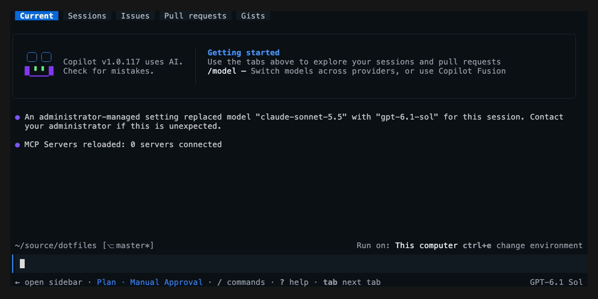

# Agents

Instructions and skills shared by Claude Code and GitHub Copilot CLI. Each tool loads the same shared instructions and skills, plus a small file of its own overrides.

| File | Purpose | Linked as |
| --- | --- | --- |
| [instructions.md](instructions.md) | Shared development instructions. | `~/.copilot/copilot-instructions.md`; imported by `CLAUDE.md` |
| [claude/CLAUDE.md](claude/CLAUDE.md) | Imports the shared instructions and adds Claude Code overrides. | `~/.claude/CLAUDE.md` |
| [claude/settings.json](claude/settings.json) | Claude Code settings. | `~/.claude/settings.json` |
| [claude/hooks](claude/hooks/README.md) | Claude Code hooks, one folder each, registered in the settings. | `~/.claude/hooks` |
| [copilot/copilot.instructions.md](copilot/copilot.instructions.md) | Copilot CLI overrides, loaded after the shared instructions. | `~/.copilot/instructions/copilot.instructions.md` |
| [copilot/hooks](#copilot-session-names) | Copilot CLI hooks, one JSON file each. | `~/.copilot/hooks` |
| [session-title](session-title/README.md) | Shared session title script used by the Claude Code and Copilot CLI hooks. | Called by the hooks |
| [skills](skills/README.md) | Shared skills. | `~/.claude/skills/<name>` and `~/.copilot/skills/<name>` |
| [skills/update-dependencies/projects.yml](skills/update-dependencies/projects.yml) | Public include and exclude lists for update-dependencies; private entries go in an untracked `projects.local.yml` next to the link. | `~/.config/update-dependencies/projects.yml` |

Keep `instructions.md` tool-neutral and put tool-specific behavior, such as co-author trailers, in the tool's overrides file. The shared file is not named `AGENTS.md`, because Copilot CLI loads `AGENTS.md` files under the working directory as repository instructions and would load it twice while working in this repository.

## Hooks

See [Hooks](claude/hooks/README.md) for the Claude Code hooks and how to add one. Both tools name new sessions after their project with the [shared session title script](session-title/README.md).

## Copilot Session Names



Copilot CLI hooks can't set a session title, so the [session-title hook](copilot/hooks/session-title.json) does the next best thing. On the first prompt of each session, [its script](copilot/hooks/session-title/session-title.sh) computes the title with the [shared session title script](session-title/README.md) and adds context asking the agent to pass that exact name to `rename_session`. Project matching, pinned emojis, and the cache are shared with Claude Code. Emojis and topics also come from Haiku, asked through Copilot CLI by [`ask-haiku.sh`](copilot/hooks/session-title/ask-haiku.sh) in a throwaway Copilot home with no tools, so no hooks or instructions load and no session is saved. The hook records seen session IDs in `~/.copilot/session-title`, so later prompts and resumed sessions are left alone, and `rename_session` preserves user-chosen names. A session started with `/new <prompt>` is named the same way, from that prompt.

The blog post [Naming Claude Code and Copilot Sessions After Their Project](https://code.dblock.org/2026/11/27/naming-claude-code-and-copilot-sessions-after-their-project.html) explains how it works.

Setup links `agents/copilot/hooks` to `~/.copilot/hooks` and enables the session tools when Copilot CLI is installed, limiting session access to the current Copilot process. To enable them without running setup, use:

```sh
copilot config sessionManagementTools.scope in-process
copilot config sessionManagementTools.enabled on
```

The agent still makes the rename call, so naming is best effort. Sessions without the tool, including non-interactive `-p` runs, skip it.

The [demo video](copilot/hooks/session-title/session-title.mp4) and GIF are recorded from [a VHS tape](copilot/hooks/session-title/session-title.tape). Run [`./record.sh`](copilot/hooks/session-title/record.sh) from `agents/copilot/hooks/session-title`, with VHS and an authenticated GitHub CLI installed. It reuses the existing GitHub token without printing it, creates an isolated Copilot home linked to the real hooks and instructions, and removes that temporary state afterwards, so unrelated sessions stay out of the recording. The tape uses plan mode and a demo-only instruction to stop after naming, without changing project files.

## Skills

See [Skills](skills/README.md) for the shared skills and how to add one.

## Setup

[scripts/setup.sh](../scripts/setup.sh) creates the links above. It re-points links that already point into this repository, so moved files are picked up, and leaves other existing files alone. Check what each tool loads with `copilot instruction list` and `/memory` in Claude Code.
