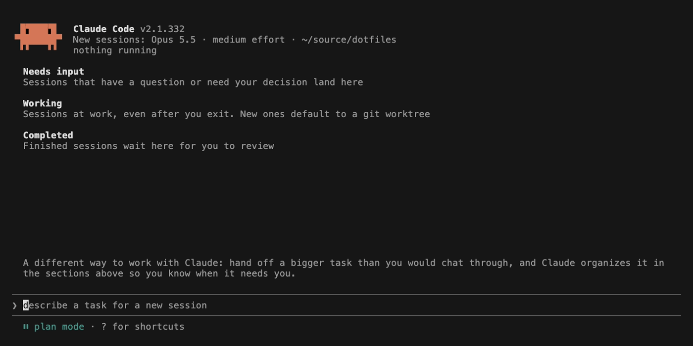

# Session Titles

The [`session-title.sh`](session-title.sh) `UserPromptSubmit` hook, registered in [settings.json](../../settings.json), names each new Claude Code session `<emoji> <name>` from its first prompt, such as `🧪 testlanes`, using the [shared session title script](../../../session-title/README.md). It returns the title as `hookSpecificOutput.sessionTitle`. Emojis and topics come from Haiku through [`ask-haiku.sh`](ask-haiku.sh), which runs `claude -p --model haiku` with hooks disabled and no saved session. Sessions that already have a title, from `/rename` or `--name`, are left alone.

The blog post [Naming Claude Code and Copilot Sessions After Their Project](https://code.dblock.org/2026/11/27/naming-claude-code-and-copilot-sessions-after-their-project.html) explains how it works.

Run [`session-title.test.sh`](session-title.test.sh) to test the hook. The [demo video](session-title.mp4) and GIF are rendered with `vhs session-title.tape` from [`session-title.tape`](session-title.tape).
